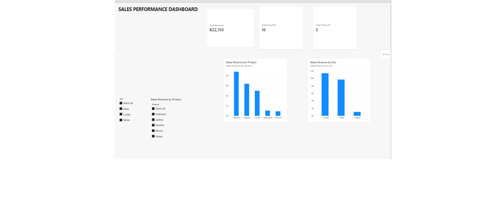

# Power BI Sales Performance Dashboard

## Project Overview

This project demonstrates how to build an interactive Sales Performance Dashboard using Microsoft Power BI.

The dashboard analyzes sales revenue, product performance, quantities sold, and sales performance across different cities in Zambia.

## Tools and Skills Used

- Microsoft Power BI Desktop
- DAX (Data Analysis Expressions)
- Data modeling
- KPI Cards
- Interactive slicers
- Data visualization
- Business performance analysis

## Key Performance Indicators

| KPI | Result |
|---|---|
| Total Revenue | K22,150 |
| Total Quantity Sold | 16 |
| Total Unique Products | 5 |

These are the results with all dashboard filters cleared.

## DAX Calculations

**Total Sales — Calculated Column**

```dax
Total Sales = SalesPractice[Quantity] * SalesPractice[Unit Price]
```

**Total Revenue — Measure**

```dax
Total Revenue = SUM(SalesPractice[Total Sales])
```

**Total Quantity — Measure**

```dax
Total Quantity = SUM(SalesPractice[Quantity])
```

**Total Products — Measure**

```dax
Total Products = DISTINCTCOUNT(SalesPractice[Product])
```

**Revenue Display — Measure**

```dax
Revenue Display = "K" & FORMAT([Total Revenue], "#,##0")
```

## Dashboard Features

- Total Revenue KPI Card
- Total Quantity KPI Card
- Total Products KPI Card
- Sales Revenue by Product chart
- Sales Revenue by City chart
- City slicer
- Product slicer

## Business Insights

- Monitor generated the highest revenue at K8,800.
- Lusaka generated the highest city revenue at K11,400.
- Five unique products generated K22,150 in total revenue.
- Interactive filters allow users to investigate product and city performance.

## Dashboard Screenshot



## Project Files

- `Power_BI_Business_Performance_Dashboard.pbix` — Power BI Desktop project file.
- `Power_BI_Dashboard.png` — Dashboard screenshot.

## Author

**Bester Malama**

Aspiring Data Analyst | Excel | SQL | Power BI

GitHub: https://github.com/bestermalam

## Project Purpose

This is a practical learning and portfolio project demonstrating foundational data analytics skills, business reporting, DAX calculations, and interactive dashboard development.
